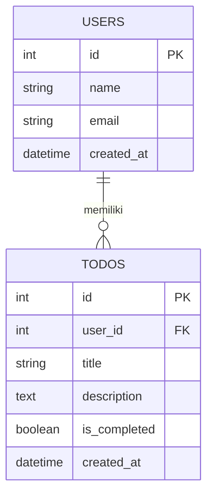

# Panduan Praktikum Pekan 8: Konfigurasi Database (MySQL), Migration, dan API Dashboard

Pada pertemuan ini, kita melanjutkan materi pengembangan backend REST API dengan mengintegrasikan database relasional menggunakan **MySQL**, **Flask-SQLAlchemy** (sebagai ORM), dan **Flask-Migrate** (untuk mengelola versi struktur database). 

Selain itu, project ini telah dilengkapi dengan antarmuka **Frontend API Tester (Dashboard)** menggunakan HTML, CSS, dan jQuery untuk memudahkan pengujian endpoint secara visual langsung dari browser.

---

## Skema Database dan Relasi

Aplikasi ini memiliki relasi *One-to-Many* antara tabel `users` dan `todos`.



---

## Struktur Project Baru

```text
root/
│
├── database/
│   ├── configurations/
│   │   └── extensions.py     # Inisialisasi db & migrate
│   ├── migrations/           # (Otomatis dibuat saat inisialisasi) File versi DB
│   ├── models/
│   │   ├── user.py           # Model User
│   │   └── todo.py           # Model Todo
│   └── seeders/
│       ├── user.py           # Data Seeder User
│       └── todo.py           # Data Seeder Todo
│
├── static/                   # Aset statis frontend (CSS & JS)
│   ├── css/
│   │   └── main.css          # Styling khusus untuk API Tester Dashboard
│   └── js/
│       └── main.js           # Logika jQuery AJAX & Session Log
│
├── templates/                # Folder khusus HTML Flask
│   └── index.html            # UI API Tester Dashboard
│
├── .env                      # File konfigurasi (kredensial database)
├── app.py                    # Entry point aplikasi Flask
├── create_db.py              # Script otomatis membuat database MySQL
├── seed.py                   # Script eksekusi seeder utama
└── requirements.txt
```

---

## Persiapan Tools (Prerequisites)

Sebelum memulai, pastikan Anda telah menyiapkan:
1. **Python** (versi 3.8 ke atas) & **Teks Editor**.
2. **XAMPP / Laragon / Native MySQL** (Pastikan service MySQL sudah dalam kondisi *Running*).
3. **Browser** untuk membuka UI Dashboard (sebagai alternatif Postman/Thunder Client).

---

## Langkah-langkah Menjalankan Aplikasi

### Langkah 1: Konfigurasi Environment (`.env`)
1. Buka folder project ini di teks editor.
2. Buat duplikat file `.env.example` dan ubah namanya menjadi `.env`.
3. Sesuaikan *credential* di dalamnya, khususnya pada bagian koneksi ke database.
   ```env
   DB_HOST=127.0.0.1
   DB_PORT=3306
   DB_USERNAME=root
   DB_PASSWORD=
   DB_NAME=todo_list_migrations
   ```

### Langkah 2: Cara Instalasi dan Aktivasi Virtual Environment
Sangat disarankan menggunakan Virtual Environment agar library (dependencies) project ini tidak mengganggu project Python lainnya.

1. Buka terminal, lalu arahkan (CD) ke direktori folder project.
2. Buat Virtual Environment baru dengan perintah:
   - Windows: `python -m venv .venv`
   - Mac/Linux: `python3 -m venv .venv`
3. Aktifkan Virtual Environment:
   - Windows (Command Prompt): `.venv\Scripts\activate`
   - Windows (PowerShell): `.venv\Scripts\Activate.ps1`
   - Mac/Linux: `source .venv/bin/activate`

### Langkah 3: Instalasi Library
Setelah Virtual Environment aktif, jalankan perintah instalasi berikut:
```bash
python -m pip install -r requirements.txt
```

### Langkah 4: Membuat Database Secara Otomatis
Alih-alih membuat database secara manual lewat phpMyAdmin, Anda dapat menjalankan script yang akan membaca konfigurasi di `.env` dan langsung membuatkannya di MySQL.
Jalankan perintah:
```bash
python create_db.py
```
*(Pastikan terminal memunculkan pesan Berhasil).*

### Langkah 5: Inisialisasi dan Migrasi Database
Agar seluruh file histori revisi tabel tersimpan rapi dalam folder `database/migrations`, jalankan perintah migrasi ini secara berurutan:

```bash
flask db init -d database/migrations
flask db migrate -m "Initial Migration: Create Users and Todos Tables"
flask db upgrade
```

### Langkah 6: Menjalankan Seeder (Data Awal)
Masukkan data awal (*dummy*) untuk user dan todo agar endpoint GET dapat menampilkan dataset yang relevan:
```bash
python seed.py
```

### Langkah 7: Cara Menjalankan Aplikasi & Menggunakan Dashboard
Setelah semua tahapan konfigurasi database selesai, jalankan server aplikasi Flask dengan perintah utama ini:
```bash
python -m flask run
```

Buka **Browser** Anda dan akses URL: `http://127.0.0.1:5000/`

Anda akan disambut oleh UI **API Tester Dashboard**. Anda dapat melakukan pengetesan endpoint secara langsung dari halaman tersebut:
- Atur URL Endpoint ke `/users` atau `/todos`.
- Klik tombol **Send**.
- Response API dalam bentuk JSON akan muncul pada panel **RESPONSE** di sebelah kanan, dan riwayat request akan tercatat di **SESSION LOG**.